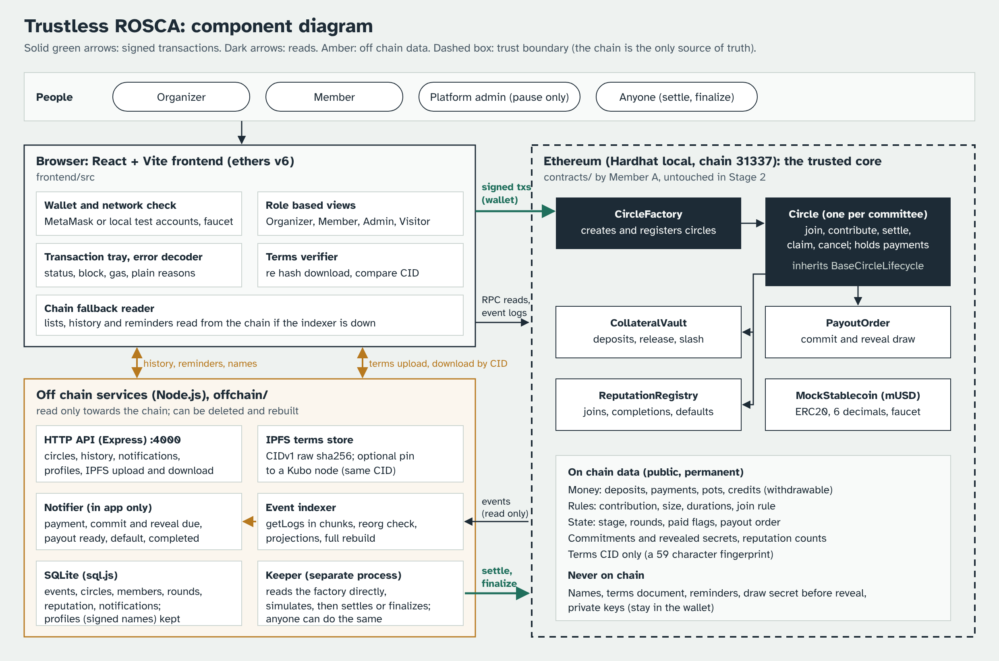

# Report sections by Member B

Sections owned by Member B in the project plan: use case and blockchain justification, related
work, component diagram, on chain versus off chain data map, and frontend. Member C assembles
the final report; these are ready to paste. Figures live in `docs/report/` and `docs/screenshots/`.

---

## 1. Use case and blockchain justification

### 1.1 The problem

A committee (ROSCA, called *committee* or *kameti* in Pakistan) is a group of people who each pay
the same amount every round. Each round one member receives the whole pot, until everyone has
had a turn. Members who receive early get an interest free loan. Members who receive late get
forced savings. Committees are widely used in Pakistan. Mehmood et al. (2019) studied how
low income groups there run them, and a World Bank study reported by Dawn found the practice is
understood by most of the population.

Everything rests on one person, the organizer, who:

* **holds the money** between collection and payout and can delay, divert or disappear with it,
* **keeps the record** of who paid (often in a notebook or a chat), which members cannot check,
* **decides the payout order**, which is valuable (early slots are a loan) and open to favouritism,
* **absorbs or hides defaults**: when a member who already took the pot stops paying, the late
  members simply lose money.

### 1.2 What our system does

The smart contracts take the organizer's four powers away:

| Organizer power today | In our DApp |
| --- | --- |
| Holds the pot | Payments sit in the `Circle` contract and deposits in `CollateralVault`. No function lets the Organizer move money. |
| Keeps the record | Every join, payment, default and payout is a public event, readable by every member. |
| Chooses the order | `PayoutOrder` runs a commit and reveal draw mixed with block randomness. |
| Absorbs defaults | Each member's deposit always covers 100% of what they still owe after their payout. A member who disappears after taking the pot is paid out of their own deposit, so the others are made whole. |

The workflows (W1 create, W2 join, W3 order draw, W4 contribute, W5 settle, W6 claim, W7 complete
and withdraw, W8 cancel) involve four roles: Organizer, Member, Admin with pause only, and anyone,
who can settle or finalize. That exceeds the brief's minimum of three workflows and two roles.
Every workflow is a real state change in a five stage lifecycle.

### 1.3 Why a blockchain and not a bank or an app

The most likely question is: "Why not JazzCash, Easypaisa, a bank, or a committee app such as Oraan?"

* **An app moves the trust problem; it does not remove it.** A company that holds the pot can
  freeze, lose or misuse it, can be hacked, and can change its rules. Our contract holds the pot,
  its rules cannot change after creation, and nobody (including us as developers) can withdraw
  someone else's money.
* **Shared state between people who do not fully trust each other.** Members need one record of
  who paid that nobody can edit after the fact. A public chain gives each member the same
  verifiable ledger without a trusted record keeper.
* **Rules that run on deadlines.** Settlement, default handling and slashing happen by code when
  a deadline passes, triggered by anyone. No organizer needs to be honest or awake.
* **Verifiable fairness.** The payout order comes from secrets that every member contributed, so
  members can check that the order was not chosen.

### 1.4 What stays off chain, and why

Blockchain is used only where it adds trust. Personal data, large documents and conveniences stay
off chain (see the data map in section 4):

* **Names** are personal data and stay off chain. Members appear on chain only as addresses. A
  display name is stored by our indexer and signed by the member's wallet.
* **The terms document** goes to IPFS. Only its CID (a fingerprint) is stored on chain, so the
  document cannot be changed without everyone noticing.
* **Reminders, history and search** come from an indexer that can be deleted and rebuilt from the
  chain at any time.

### 1.5 Honest limits of the justification (for the limitations section)

* **Access:** members need a wallet, a stablecoin and gas money. Our prototype uses a mock
  stablecoin on a local Hardhat chain; a real deployment would need an on ramp and a cheap L2.
* **Legal status** of crypto assets in Pakistan is uncertain; we make no claim of compliance.
* **Collateral is a barrier** for poorer members. We reduce it by scaling it to payout position
  (the last member keeps nothing locked), but the first member locks (N minus 1) contributions.
* **Reputation is per address,** so a defaulter can start fresh with a new address (Sybil). The
  real protection is the collateral; reputation is only a small extra signal.
* **The Admin pause** is a trust point. It is limited to joining and paying, for at most 7 days,
  and cannot block refunds, settlement or claims.

---

## 2. Related work

| Work | What it does | How we differ |
| --- | --- | --- |
| **Sharma and Chandrakar (2025)**, *Blockchain driven trust evaluation and secure key agreement protocol for ROSCA*, International Journal of Information Technology 17. | A four layer architecture that scores the trustworthiness of ROSCA **operators** with fuzzy logic and stores a time stamped trust index on a blockchain, plus a key agreement protocol. | They keep an operator and rate it. We remove the operator's control of money entirely. Their trust index idea appears in our `ReputationRegistry`, on a public chain and limited to members' own records. |
| **Sharma and Chandrakar (2024)**, *TruChit: a blockchain based trusted chit fund system with creditworthiness evaluation*, Procedia Computer Science. | A chit fund (ROSCA) system with a machine learning creditworthiness score. | We secure the pot with collateral rather than predicting who will default. Prediction and collateral could be combined in future work. |
| **Batool, Sion, Tonga Naha and Zhang (2023)**, *B-ROSCA: a smart contract based selection of ROSCA communities using collateral*, IEEE DAPPS 2023. | Smart contract collateral, plus social network analysis to form groups among strangers. | B-ROSCA asks for collateral to enable groups of strangers. Ours is scaled to payout position (100% of what is still owed after the payout), slashed automatically on default, with a fair commit and reveal draw and a threat model with attack tests. Member matching is future work. |
| **WeTrust Trusted Lending Circles (2017)**, Ethereum ROSCA MVP, audited by OpenZeppelin. | One of the first ROSCAs on Ethereum, for trusted groups of friends and family, with a bidding mechanism for the pot. | WeTrust assumed members already trust each other and had no collateral against a member who takes the pot and leaves. We cover exactly that case and add an off chain layer (IPFS terms, indexer, reminders). |
| **Mehmood et al. (2019)**, *Towards digitization of collaborative savings among low income groups*, Proc. ACM HCI 3 (CSCW). | User studies of committees in Pakistan and a digital ROSCA prototype for low literacy users. | Informs our UI: plain language, reminders before deadlines, visible payment status. We did not run a user study; that is future work. |
| Hackathon projects such as Tanda, ROSA and Starosca (listed in our team notes). | Collateral based ROSCAs on various chains. | Not reviewed in depth. We do not claim to be first; our focus is position scaled collateral, an explicit threat model with attack tests, and measured gas savings. |

---

## 3. Component diagram

*Figure: components and trust boundary (`docs/report/component-diagram.png`, source `component-diagram.svg`).*

How information flows:

1. **Create (W1).** The Organizer's browser hashes the terms, uploads them to the IPFS store
   through the API, checks that the returned CID equals its own hash, and only then sends
   `CircleFactory.createCircle` with the CID.
2. **Every other action** is a transaction signed in the member's wallet and sent straight to the
   contracts. The off chain services are never in the path of a money moving transaction.
3. **The indexer** polls `eth_getLogs` for every known contract and applies events, in block and
   log order, to SQLite. The **notifier** turns events and deadlines into in app reminders.
4. **The keeper** reads circles from the factory (not from the indexer), simulates
   `settleRound` / `finalizeDraw` / `cancel`, and sends only calls that will succeed.
5. **The browser** reads balances, roles and deadlines from the chain, and history, names and
   reminders from the indexer API. If the API does not answer, it reads those from the chain too.

Trust boundary: **the contracts are the only source of truth.** Every off chain part is
read only towards the chain (the keeper only calls functions that anyone may call). Deleting all
off chain data loses only display names, which members can sign again.

---

## 4. On chain versus off chain data map

| Data | Where | Why | Integrity / failure handling |
| --- | --- | --- | --- |
| Deposits (collateral) | On chain: `CollateralVault.collateralOf` | Money must be held by code | Only registered circles can move it; tests by A and C |
| Round payments and pots | On chain: `Circle` balance, `rounds`, `withdrawable` | Money | Pull payments, reentrancy guard |
| Rules (amount, size, durations, join rule) | On chain: `Circle.config` | Must not change after people join | Set once in `initialize` |
| Lifecycle stage, current round, paid flags | On chain | Decides who may do what | State machine in `BaseCircleLifecycle` |
| Payout order, commitments, revealed secrets | On chain: `PayoutOrder` | Fairness must be checkable | Commit bound to member and circle |
| Reputation counts | On chain: `ReputationRegistry` | Shared across circles | Only registered circles write |
| Terms document (PDF or text) | **Off chain: IPFS** (local store, optional Kubo pin) | Large and human readable; storing it on chain is costly | **CID on chain**; the browser re hashes the download and refuses a mismatch (tested) |
| Terms CID | On chain: `config.termsCid` | The fingerprint that anchors the document | Immutable after creation |
| Display names | **Off chain: indexer `profiles` table** | Personal data must not go on chain | Signed by the wallet (EIP 191); stale or forged signatures rejected; never needed for any action |
| Event history, circle lists, per account history | **Off chain: indexer SQLite** (cache) | Fast lists and search | Rebuilt from events at any time (tested); reorg or reset detected by block hash; UI falls back to chain logs |
| Reminders (due, reveal, payout ready, default) | **Off chain: notifier** | Convenience, depends on time | Recomputed every tick; UI computes them from the chain if the notifier is down |
| Draw secret before reveal | **Off chain: member's browser** (localStorage + downloaded backup) | Must stay secret until reveal | Checked against the on chain commitment before reveal |
| Private keys | **Never stored by us**: MetaMask | Security | Not in the repo; `.env` is git ignored; keeper uses unlocked local accounts or a local `.env` key |

---

## 5. Frontend

**Stack:** React 18 + Vite 5, ethers v6, no UI framework. Code in `frontend/src`.

**Wallet and network.** *Connect MetaMask* uses the injected provider. A network check compares
the wallet's chain with the deployment (`chainId` 31337) and offers *Switch network*, which adds
Hardhat Local to MetaMask if needed. *Get test mUSD* calls the faucet. *Show mUSD in MetaMask*
adds the token. On the local chain only, *Local test account* lets one browser act as any of the
Hardhat accounts, which is useful for rehearsing the four member demo and for the automated UI test.

**Role based views.** The circle page shows role chips (Organizer, Member, Receives this round,
Admin, Visitor) and an action panel with only the actions the contract would accept now:

| Workflow | UI | Who sees it |
| --- | --- | --- |
| W1 Create | *Organize* page: amounts, timing presets, terms (write, upload or existing CID), live deposit calculation | Anyone (becomes Organizer) |
| W2 Join | *Approve and join (2 steps)*, balance warning | Non members while open |
| W3 Draw | *Commit secret* (secret generated and saved in the browser, backup downloaded), *Reveal secret* (checked against the on chain commitment first), *Finalize draw* | Members; finalize: anyone |
| W4 Contribute | *Approve and pay (2 steps)*, deadline, closed window warning | Participants who have not paid |
| W5 Settle | *Settle round*, enabled when everyone paid or the deadline passed | Anyone (the keeper does it too) |
| W6 Claim | *Claim payout* when `withdrawable > 0` | Anyone with a credit |
| W7 Complete and withdraw | *Finish and withdraw*: shows the deposit returned at completion and *Withdraw* any credit left | Members of a completed circle |
| W8 Cancel | *Cancel circle* with confirmation | Organizer while open; anyone after the join deadline |
| Admin | *Pause for up to 7 days* / *Unpause* | Holder of `PAUSER_ROLE` |

The Organizer also gets an *Organizer view* (fill progress, who has paid, invite link) and a list
of their circles. Members get *My circles* and *Activity* (reminders, history, record).

**Transaction status and readable errors.** Each action goes through the transaction tray:
*Confirm in your wallet*, then *Waiting to be mined* with the hash, then *Confirmed* with block
and gas, or *Failed* / *Rejected*. Multi step actions show *step 1 of 2: Approve*. Errors are
decoded in `frontend/src/lib/errors.js`: every revert string in the contracts maps to a plain
sentence. OpenZeppelin custom errors are decoded through the ABIs (missing role, pause, ERC20
balance and allowance). Wallet rejection, missing gas money, and the stale MetaMask nonce after a
Hardhat restart also get plain messages. Because ethers estimates gas before asking the wallet, a
call that would revert fails before the member signs anything.

**Visual design.** The page is laid out like a committee register: ruled rows, tabular numbers,
and three colours that each mean one thing (green paid, amber due, red missed). The circle page
shows a ring of seats in payout order, marking the current recipient and who has paid.

**Off chain trust in the UI.**

* *Terms check:* the browser downloads the terms by CID (our service first, then public
  gateways), hashes them with Web Crypto and compares with the on chain CID. A mismatch shows
  *Do not trust this document*. Screenshot `17-tampered-terms-detected.png`.
* *Indexer down:* a health check every 5 s switches the UI to chain reads. Lists come from
  `factory.getCircles()`, history from `getLogs` across the circle, vault and draw contracts, and
  reminders are computed in the browser. Screenshot `16-indexer-offline-chain-fallback.png`.

**Screenshots** (from the automated UI run, `docs/screenshots/`): wallet and faucet (01),
create form (02), terms verified (03), readable error (04), draw (05), active round (06), payout
ready (07), payment due (08), default recorded (09), organizer after a default (10), finish and
withdraw (11a), completed (11), activity (12), my circles (13), admin pause (14), cancel (15),
indexer offline (16), tampered terms (17).

---

## 6. Member B contribution row (for the contribution matrix)

| Member | Owned work and packages | Evidence | Effort and justification |
| --- | --- | --- | --- |
| Member B | IPFS terms storage, event indexer with API (SQLite), notifier, keeper, full React frontend; end to end test, indexer rebuild test, off chain unit tests, browser test; README and `.env.example`; report sections above | Commits in `offchain/`, `frontend/`, `test/e2e/`; tag `handoff_2`; `docs/handoff/handoff_2.md`; 26 automated tests; demo of wallet setup, Organizer flow, notifications and history | Three runtimes (Node.js services, IPFS, React) plus all integration with A's contracts in 4 days. Found and reported one contract bug (B-1) without editing contracts |

## Sources

* Sharma A., Chandrakar P. (2025). Blockchain driven trust evaluation and secure key agreement protocol for rotating savings and credit association. *International Journal of Information Technology* 17, 4181 to 4200.
* Sharma A., Chandrakar P. (2024). TruChit: a blockchain based trusted chit fund system with creditworthiness evaluation. *Procedia Computer Science*. doi:10.1016/j.procs.2024.04.129
* Batool Z., Sion S. I., Tonga Naha R., Zhang K. (2023). B-ROSCA: a smart contract based selection of ROSCA communities using collateral. *IEEE DAPPS 2023*, Athens.
* Mehmood H., Ahmad T., Razaq L., Mare S., Usmani M. Z., Anderson R., Raza A. A. (2019). Towards digitization of collaborative savings among low income groups. *Proc. ACM HCI* 3 (CSCW), Article 35. doi:10.1145/3359137
* WeTrust (2017). rosca-contracts (GitHub) and the OpenZeppelin audit of the WeTrust ROSCA contract (28 Feb 2017).
* Dawn (Pakistan): reporting on a World Bank study of committees, and on Oraan, a committee app.
